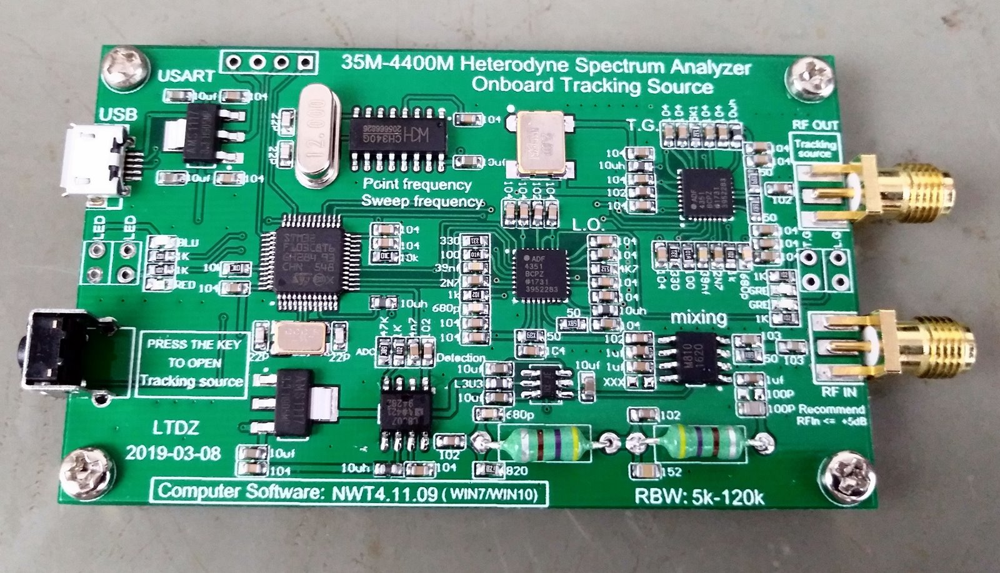

# Pakespec

Free, cross-platform (Linux and Windows) software to control the **LTDZ 35-4400M** family of spectrum analyzer and tracking generator boards (35 MHz to 4.4 GHz, STM32F103 + two ADF4351 + AD8307).

Why: the software that came with this board (WinNWT4) is Windows-only, the newer NWT releases from its author have Linux builds but state that they are not suitable for LTDZ boards, and there is no open, cross-platform client for it.

## About the project



I have had this board since 2019. It is a 35 MHz to 4.4 GHz spectrum analyzer with a tracking generator, built around an STM32F103, two ADF4351 synthesizers and an AD8307 detector. I made a video about it and wrote [a post](https://www.pakequis.com.br/2019/08/analisador-de-espector-de-35-mhz-44-ghz.html) (in Portuguese). I used the software that was recommended for it, WinNWT4, which is no longer offered on its author's page.

Years later the comments on that post were still about the same thing: the software. It runs only on Windows, its installer is picky about the folder it goes in, and in 2025 someone was still asking where to download it. Its author (DL4JAL) still publishes Linux builds and source code for the newer NWT4000 and NWT2 programs, but his page says the software is not suitable for LTDZ boards and that their firmware is faulty. I use Linux and Windows on the same machine, so I wanted something that works on both and that anyone can read, fix and build.

Pakespec started as a serial port and a lot of experiments, until the board's protocol made sense. It multiplies every frequency by 10, ignores commands while it sweeps and goes mute if it receives one it does not know. Everything I found is in [`docs/serial-protocol.md`](docs/serial-protocol.md), and the rest of the story is in [`docs/full-record.md`](docs/full-record.md).

I built it with the help of Claude (Claude Code), which also appears as co-author in the commits.

The name is my handle, Pakequis, plus the start of "spectrum": Pakespec.

Want a board to play with? [Here it is on AliExpress](https://s.click.aliexpress.com/e/_c3DrudED) (affiliate link: it costs you nothing extra, and I may earn a small commission).

## Screenshots


A sweep from 2.0 to 2.6 GHz with a 10 cm antenna (Instrument style, dark theme): a Wi-Fi burst near 2.42 GHz stands out of the noise floor, with three markers. Levels are in dBm on the built-in reference scale.


The same band in the Classic style with the phosphor theme, with the System menu open (port, style, theme, language and About).

## Status (2026-10-17)

Early stage, working on the real board on Linux and Windows.

- **Protocol confirmed** on the board (see `docs/serial-protocol.md`): sweep, measure and generator commands, the board multiplies every frequency by 10, steps wrap at 10 MHz.
- **Rust core** (protocol, board access, simulator) with unit and integration tests, hardware tests that need a board, and a CI workflow.
- **Graphical application** (egui): four selectable screen styles (Bench, Classic, Instrument, Modern) with ready-made presets, dark, light and phosphor themes, max and min hold traces, averaging, markers with peak search, English and Portuguese, serial port selection with board detection.
- **Levels in dBm** from 35 MHz to 4.4 GHz with a calibration built in (`docs/calibration.md`). It follows a reference scale taken from the reference board, so the levels are relative, not absolute. A `calibration.toml` next to `settings.toml` replaces it.
- **Generator screen** (the board's tracking source): sets a frequency and shows the reading through a cable from RF OUT to RF IN.
- **For other programs:** a command-line tool with CSV and JSON output and a line-based server mode, and an MCP server for language models (`docs/automation.md`).
- Hardware research and documented experiments on the board.

## Where to read first

1. `docs/full-record.md`: everything done so far, tools, timeline, open items.
2. `docs/serial-protocol.md`: the board protocol on one page.
3. `docs/hardware.md`: chips, connectors and specifications.
4. `docs/next-steps.md`: what to do, in order.
5. `docs/decisions.md`: choices already made (name, license, platforms) and what is still open.
6. `docs/feature-spec.md`: the feature list, what is done, what is blocked, and the decisions needed.
7. `docs/testing.md`: how the tests are organized and how to run them.
8. `docs/automation.md`: the command line and the MCP server in detail.
9. `docs/calibration.md`: how raw readings become dBm.

## Folders

- `src/`: Rust code. `protocol.rs` (wire format), `board.rs` (talking to a board), `sim.rs` (board simulator), `ports.rs` (port detection), `worker.rs` (background sweeps), `calibration.rs` (raw to dBm), `automation.rs` and `mcp.rs` (command line and MCP server logic), `panel.rs`, `scale.rs` and `trace.rs` (front panel, axis scale and trace data), `theme.rs`, `i18n.rs` and `settings.rs`, `ui/` (egui screens), `bin/` (the application, the command-line tool and the MCP server).
- `locales/`: interface translations.
- `tests/`: integration tests against the simulator.
- `tools/`: standalone Python client used during the research.
- `experiments/`: test scripts used during the research. Not production code.
- `docs/`: documentation.

## Quick usage

Graphical application (pick the port, press Sweep; the simulator entry works without a board):

```
cargo run --release --bin pakespec
```

### Command line

With the board on USB (CH340, `/dev/ttyUSB0` on Linux), a sweep printed as CSV (`freq_hz,ch1,ch2,dbm`: raw values and dBm on the built-in scale):

```
cargo run --release --bin pakespec-cli -- --port /dev/ttyUSB0 --start 35000000 --stop 1000000000 --points 101
```

More examples (add `--simulate` to try them without a board; without `--port` the only matching board is used):

```
pakespec-cli --list-ports --json                         # serial ports; the likely board is marked
pakespec-cli --json --start 2000000000 --stop 2600000000 --points 300   # one sweep as JSON, with the peak
pakespec-cli --measure 100000000                         # one reading at 100 MHz (turns the output on briefly)
pakespec-cli --generator 50000000                        # tracking source on at 50 MHz
pakespec-cli --generator-off                             # and off again
echo '{"cmd":"sweep","start":35000000,"stop":1000000000,"points":101}' | pakespec-cli --serve
```

`--serve` keeps the board open and answers one JSON request per input line. Sweeps with the tracking source need the S1 button on the board turned on; a fixed-frequency output (`--generator`, `--measure`) works without it, so ask what is on RF OUT before using them.

### MCP server (for language models)

`pakespec-mcp` speaks JSON-RPC over standard input and output. Add it to an MCP client (for example in its `mcpServers` configuration):

```json
{"mcpServers": {"pakespec": {"command": "pakespec-mcp", "args": ["--port", "/dev/ttyUSB0", "--no-generator"]}}}
```

Tools: `list_ports`, `status`, `sweep`, and `measure`, `generator`, `generator_off`. `--no-generator` hides the last three, the ones that put a signal on RF OUT, so the model can only observe. Try it without a client:

```
printf '%s\n' '{"jsonrpc":"2.0","id":1,"method":"tools/list"}' | pakespec-mcp --simulate
```

Details, request formats and exit codes: [`docs/automation.md`](docs/automation.md).

Tests: `cargo test` needs no hardware. With the board connected, RF OUT cabled to RF IN and S1 on: `cargo test -- --ignored --test-threads=1`. If the board does not answer, unplug and replug the USB cable. Do not send unknown commands to the board: it stays silent until it is replugged.

## License

MIT - see [`LICENSE`](LICENSE).

## Cautions

- Recommended RF input up to +5 dBm; use an attenuator with strong sources.
- Do not open other serial devices on the machine while testing; only the board's CH340 (`1a86:7523`).
