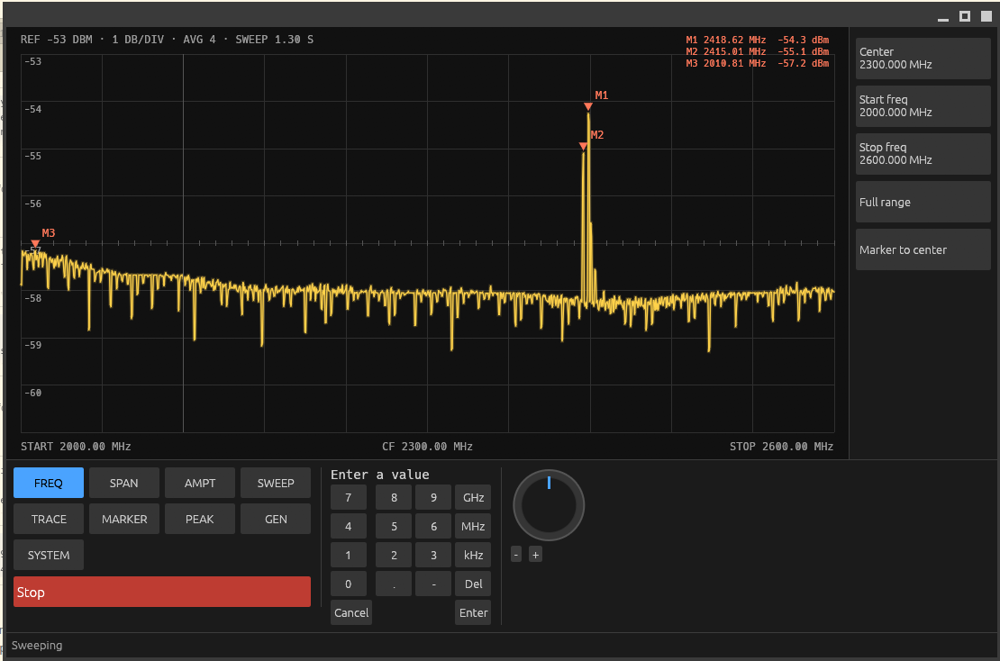
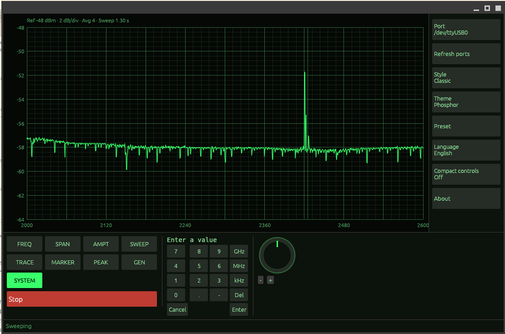

# Pakespec

Free, cross-platform (Linux and Windows) software to control the **LTDZ 35-4400M** family of spectrum analyzer and tracking generator boards (35 MHz to 4.4 GHz, STM32F103 + two ADF4351 + AD8307).

Why: the vendor software for this board is Windows-only and unmaintained, and there is no open, cross-platform client for it.



A sweep from 2.0 to 2.6 GHz with a 10 cm antenna (Instrument style, dark theme): a Wi-Fi burst near 2.42 GHz stands out of the noise floor, with three markers. Levels are in dBm on the built-in reference scale.



The same band in the Classic style with the phosphor theme, with the System menu open (port, style, theme, language and About).

## Status (2026-10-17)

Early stage, working on the real board on Linux and Windows.

- **Protocol confirmed** on the board (see `docs/serial-protocol.md`): sweep, measure and generator commands, the board multiplies every frequency by 10, steps wrap at 10 MHz.
- **Rust core** (protocol, board access, simulator) with unit and integration tests, hardware tests that need a board, and a CI workflow.
- **Graphical application** (egui): four selectable screen styles (Bench, Classic, Instrument, Modern) with ready-made presets, dark, light and phosphor themes, max and min hold traces, averaging, markers with peak search, English and Portuguese, serial port selection with board detection.
- **Levels in dBm** from 35 MHz to 4.4 GHz with a calibration built in (`docs/calibration.md`). It follows a reference scale taken from the reference board, so the levels are relative, not absolute. A `calibration.toml` next to `settings.toml` replaces it.
- **Generator screen** (the board's tracking source): sets a frequency and shows the reading through a cable from RF OUT to RF IN.
- **For other programs:** a command-line tool with CSV and JSON output and a line-based server mode, and an MCP server for language models (`docs/automation.md`).
- Hardware research and documented experiments on the board.

## Where to read first

1. `docs/full-record.md`: everything done so far, tools, timeline, open items.
2. `docs/serial-protocol.md`: the board protocol on one page.
3. `docs/hardware.md`: chips, connectors and specifications.
4. `docs/next-steps.md`: what to do, in order.
5. `docs/decisions.md`: choices already made (name, license, platforms) and what is still open.
6. `docs/feature-spec.md`: the feature list, what is done, what is blocked, and the decisions needed.
7. `docs/testing.md`: how the tests are organized and how to run them.

## Folders

- `src/`: Rust code. `protocol.rs` (wire format), `board.rs` (talking to a board), `sim.rs` (board simulator), `ports.rs` (port detection), `worker.rs` (background sweeps), `calibration.rs` (raw to dBm), `automation.rs` and `mcp.rs` (command line and MCP server logic), `panel.rs`, `scale.rs` and `trace.rs` (front panel, axis scale and trace data), `theme.rs`, `i18n.rs` and `settings.rs`, `ui/` (egui screens), `bin/` (the application, the command-line tool and the MCP server).
- `locales/`: interface translations.
- `tests/`: integration tests against the simulator.
- `tools/`: standalone Python client used during the research.
- `experiments/`: test scripts used during the research. Not production code.
- `docs/`: documentation.

## Quick usage

Graphical application (pick the port, press Sweep; the simulator entry works without a board):

```
cargo run --release --bin pakespec
```

Command line:

With the board on USB (CH340, `/dev/ttyUSB0` on Linux), a sweep printed as CSV (`freq_hz,ch1,ch2`, raw values):

```
cargo run --release --bin pakespec-cli -- --port /dev/ttyUSB0 --start 35000000 --stop 1000000000 --points 101
```

Without `--port`, the only USB serial converter that matches the board is used; `--list-ports` shows what was found. Add `--simulate` to run without a board. Sweeps with the tracking source need the S1 button on the board turned on; a fixed-frequency output (`--generator`, `--measure`) works without it.

For other programs: `--json` and `--measure HZ` print JSON, `--serve` keeps the board open and answers one JSON request per line, and `pakespec-mcp` is an MCP server for language models. See [`docs/automation.md`](docs/automation.md).

Tests: `cargo test` needs no hardware. With the board connected, RF OUT cabled to RF IN and S1 on: `cargo test -- --ignored --test-threads=1`. If the board does not answer, unplug and replug the USB cable. Do not send unknown commands to the board: it stays silent until it is replugged.

## License

MIT - see [`LICENSE`](LICENSE).

## Cautions

- Recommended RF input up to +5 dBm; use an attenuator with strong sources.
- Do not open other serial devices on the machine while testing; only the board's CH340 (`1a86:7523`).
